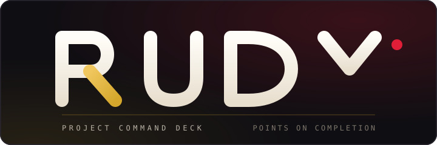

<p align="center">
  
</p>

<h1 align="center">Rudy</h1>

Rudy is a project and task command deck where completed work earns points. A
Project Manager approves proposals, builders record acceptance evidence, reviewers
sign off, and the ledger mints points exactly once when a task is completed.

The repository contains:

- `back/` — Go 1.26 HTTP API, SQLite, embedded SQL migrations, bearer-token sessions.
- `front/` — React 19 + Vite + TypeScript client with TanStack Query, Zustand and Recharts.
- `docs/` — developer documentation, user guides and forward-looking plans.

## Quick start

```bash
# terminal 1 — API on :8080 (creates rudy.db on first run)
cd back
cp .env.example .env   # optional: review config before first start
go run .

# terminal 2 — client on :5173 (proxies /api to :8080)
cd front
npm install
npm run dev
```

Create an account on the landing page. Choose **Project Manager** to open a project,
or any builder role to propose work. See [docs/getting-started.md](docs/getting-started.md)
for configuration and testing.

## Documentation

| Document | Contents |
| --- | --- |
| [docs/getting-started.md](docs/getting-started.md) | Local setup, configuration, tests, first run |
| [docs/architecture.md](docs/architecture.md) | System design, database schema, lifecycle, transactions |
| [docs/api.md](docs/api.md) | HTTP contract, auth, request/response shapes |
| [docs/frontend.md](docs/frontend.md) | Routes, state, permissions, theming, charts |
| [docs/user-guide.md](docs/user-guide.md) | End-user walkthrough and product rules |
| [docs/roadmap.md](docs/roadmap.md) | Planned features and prioritisation |
| [docs/plans/](docs/plans/) | Detailed feature plans for notifications, chat, articles and AI |

## Test

```bash
cd back && go test ./...
cd front && npm run typecheck && npm run build
```
